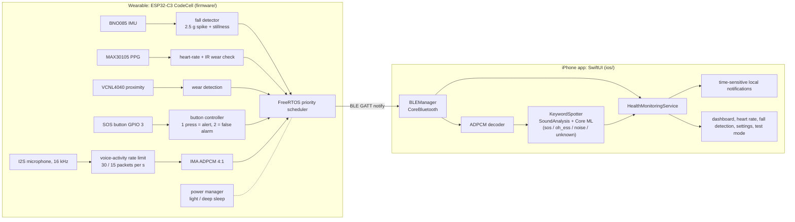
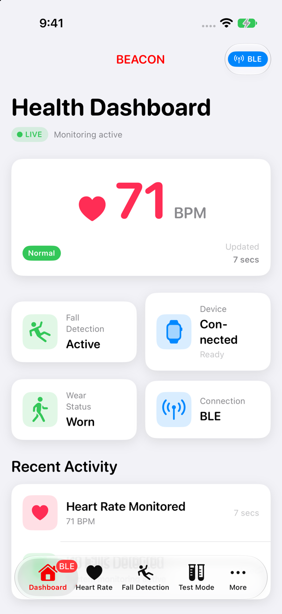
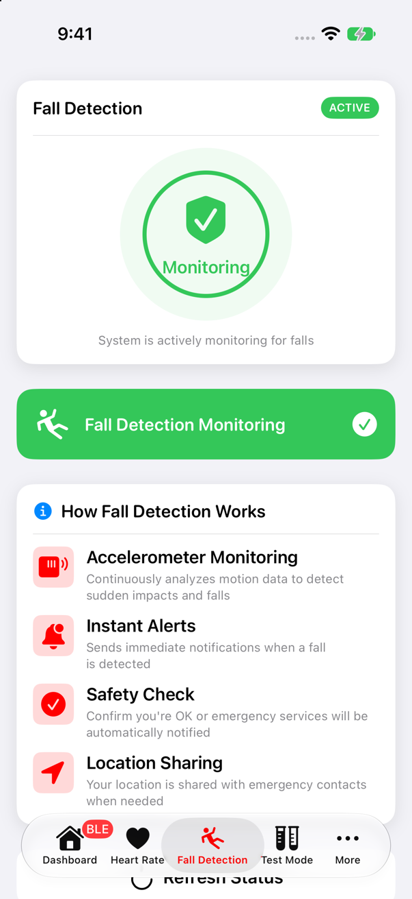
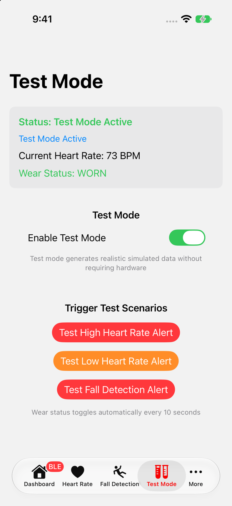
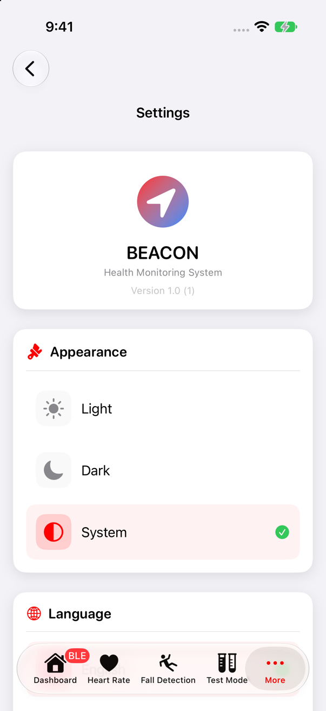

# BEACON: Smart Wearable for Fall Detection and Emergency Alerts

A wrist-worn ESP32-C3 device and a SwiftUI iPhone app, connected only over Bluetooth Low Energy:
- the **wearable** measures heart rate, detects falls and wear state, handles the SOS button, and streams compressed
  microphone audio;
- the **iPhone** decodes that audio, spots the spoken keyword "SOS" with an on-device Core ML model, and raises
  emergency notifications.

*Student team project. Software lead: [@gkasturirag12345-boop](https://github.com/gkasturirag12345-boop). This
repository holds the final integrated firmware, iOS app and keyword-model training pipeline.*

## Problem
Older adults and lone workers who fall, or who suddenly need help, often cannot reach a phone. The wearable detects a fall,
a missing heartbeat and a press of the SOS button. The phone checks the streamed heart rate against an abnormal range
and detects a spoken "SOS". All of them become phone alerts without the wearer touching the phone.

## Architecture

**Processing is split:**
- The **wearable** computes heart rate, wear state, fall events, a missing-heartbeat alert (`HEART_STOP`), button
  events and audio compression. The voice-activity detector does not drop audio. It sets the packet rate: 30 per
  second while someone is speaking, 15 otherwise.
- The **iPhone** decodes audio and runs keyword spotting. It also applies the high/low heart-rate thresholds, raises
  the alerts, shows the location and runs all of the user interface.
- The firmware accepts `RESET_ALERT` and `TRIGGER_FALL` on the control characteristic. The current app sends neither:
  it writes only `SOS_KEYWORD_<confidence>`.

### BLE GATT profile (service `12345678-9012-3456-7890-1234567890AB`)
| Characteristic | UUID suffix | Direction | Content |
|---|---|---|---|
| Heart rate | `…90AC` | notify | beats per minute (uint8) |
| Alert status | `…90AD` | notify | text alerts: fall, missing heartbeat, manual SOS, false alarm, wear state |
| Control | `…90AE` | write | firmware accepts `RESET_ALERT`, `TRIGGER_FALL`; the app sends `SOS_KEYWORD_<conf>` (see Limitations) |
| Audio | `…90AF` | notify | IMA-ADPCM compressed microphone audio, 16 kHz (an 8 kHz low-power rate is defined but not used) |

## Repository layout
```
├── firmware/Code_that_works2/   ESP32-C3 sketch: sensors, fall/HR/wear logic, button, audio, BLE, scheduler, power
│   └── sketch.yaml              pinned core and library versions (arduino-cli profile)
├── ios/                         Xcode project (BEACON6.xcodeproj, scheme "BEACON") and the SwiftUI app source
├── ml/                          Core ML keyword-classifier training: augmentation script, CreateML training script, report
└── docs/                        screenshots, development history
```

## Building
**Firmware** (arduino-cli 1.x; board definitions for the generic ESP32-C3):
```bash
cd firmware/Code_that_works2
arduino-cli compile --profile beacon        # installs the pinned core + libraries on first use
```
Verified 2026-11-18: esp32:esp32 3.3.1; the sketch uses 736 KB (56%) of flash and 27.7 KB of RAM.

**iOS app** (Xcode 26, iOS 26 SDK): open `ios/BEACON6.xcodeproj`, select the `BEACON` scheme, then set your own
development team and bundle identifier. The keyword model is not in the repository (see `ml/README.md`). Train it, or
place `SOSKeywordClassifier.mlmodel` in `ios/BEACON6/Resources/`. Without the model the app still builds and runs, but
voice SOS is disabled. Verified 2026-11-18: builds and runs on the iPhone 17 simulator (iOS 27.2).

### Screenshots (iOS simulator, simulated data, no wearable)
| Dashboard | Fall detection | Test mode | Settings |
|---|---|---|---|
|  |  |  |  |

*These come from the app's own `TestSimulator`, not from hardware. It generates heart rate, motion and wear state, so
"Device Connected" and the BPM values on the dashboard are simulated. Captured with the Debug-only launch arguments
`-initialTab <n> -simulate YES -noPermissionPrompts YES`; Release builds compile these hooks out. Hardware photos and
a live demo are not included yet.*

## Results and validation
| What | Evidence | Status |
|---|---|---|
| Firmware compiles for ESP32-C3 with pinned libraries | `arduino-cli compile --profile beacon` | verified 2026-11-18 |
| iOS app builds and launches (simulator) | Xcode build, screenshots above (simulated data) | verified 2026-11-18 |
| Keyword model accuracy: 95.5% train, 93.2% validation, 90.7% test (4 classes) | `ml/training_report.txt` (CreateML, 2025-11-11) | as reported by CreateML; not re-run in this cleanup |
| End-to-end behaviour on hardware (falls, heart rate, SOS over BLE) | team testing during the project | not documented in this repository |

## Limitations
- **The wearable does not act on a voice SOS.** The iPhone detects the keyword, raises its own alert and sends
  `SOS_KEYWORD_<confidence>` to the device. The current firmware logs it as an unknown command.
- Alerts are local iPhone notifications. There is no automatic call, SMS or caregiver contact.
- The fall detector uses a fixed-threshold heuristic (impact over 2.5 g followed by stillness). It is not a trained
  model and has not been validated on a fall dataset.
- The keyword model's per-class metrics were not recorded (`ml/training_metrics.json` holds zeros). The model file
  and the audio datasets are not published.
- The power states are implemented, but battery life was not measured.

### Known issues
- A detected fall calls `delay(10000)` inside `onFallDetected`, so the task that detected it (or the BLE callback for
  `TRIGGER_FALL`) blocks for 10 s. Not changed here because it needs hardware to retest.
- The Heart Rate tab loads data when it appears and on pull-to-refresh. It does not update live, and opened first it
  shows "Waiting for heart rate data" even while data arrives.

## Future work
Firmware handling of the voice-SOS command; caregiver notification (SMS or push through a backend); validation of
fall detection on recorded fall and non-fall activities; per-class keyword metrics; battery-life measurement.

## Development history
BEACON grew out of an earlier Design & Innovation Project prototype. It went through a Wi-Fi-plus-BLE generation, a
Node.js BLE bridge and an Edge Impulse keyword model before reaching this BLE-only, Core ML version. See
[`docs/history.md`](docs/history.md). The earlier component repositories are kept privately as historical
references and are not separate projects.

## Acknowledgements and licences
Third-party libraries and their licences are listed in [`THIRD_PARTY_NOTICES.md`](THIRD_PARTY_NOTICES.md). This
repository does not include the Edge Impulse SDK or any Edge Impulse export.
